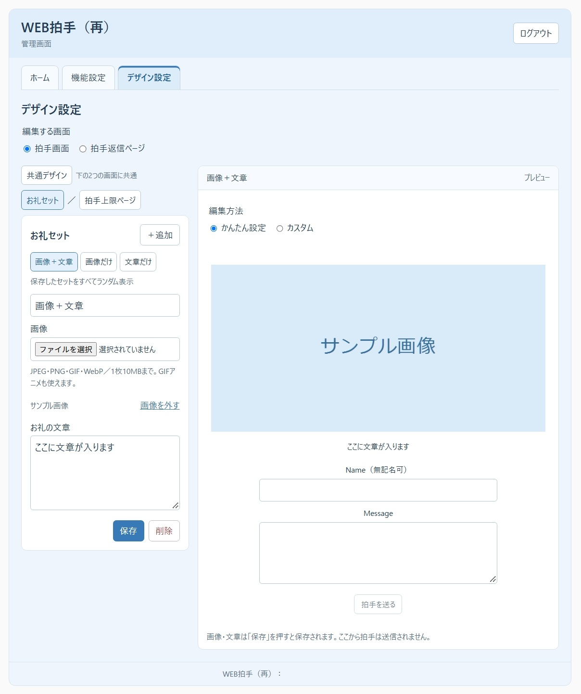
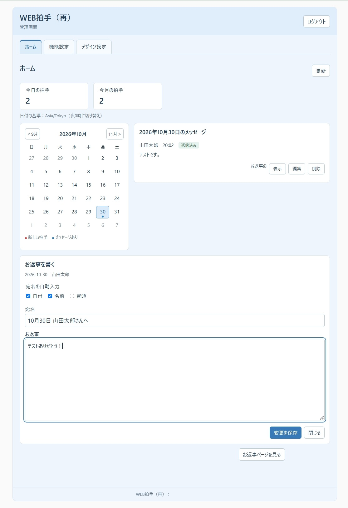
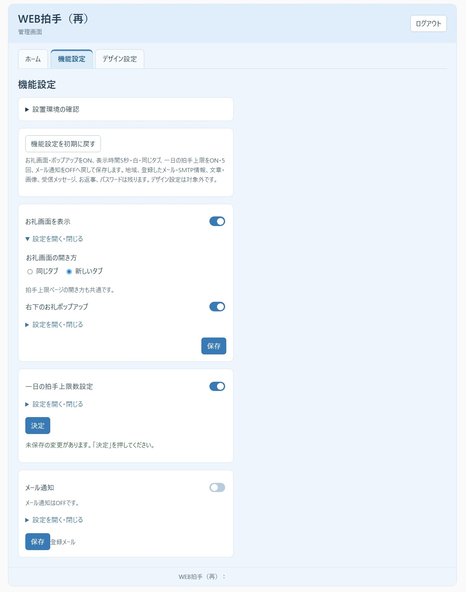
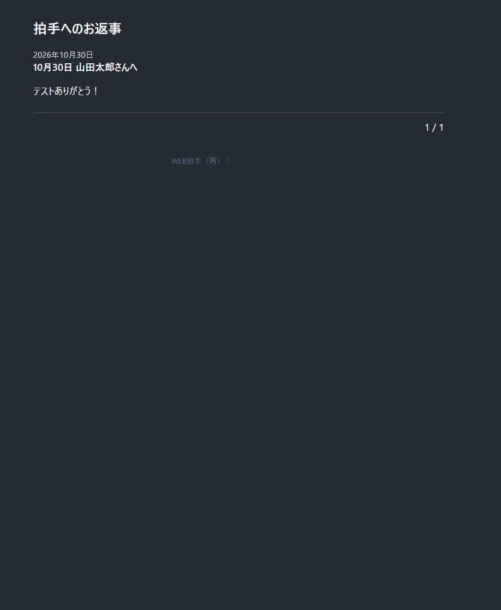
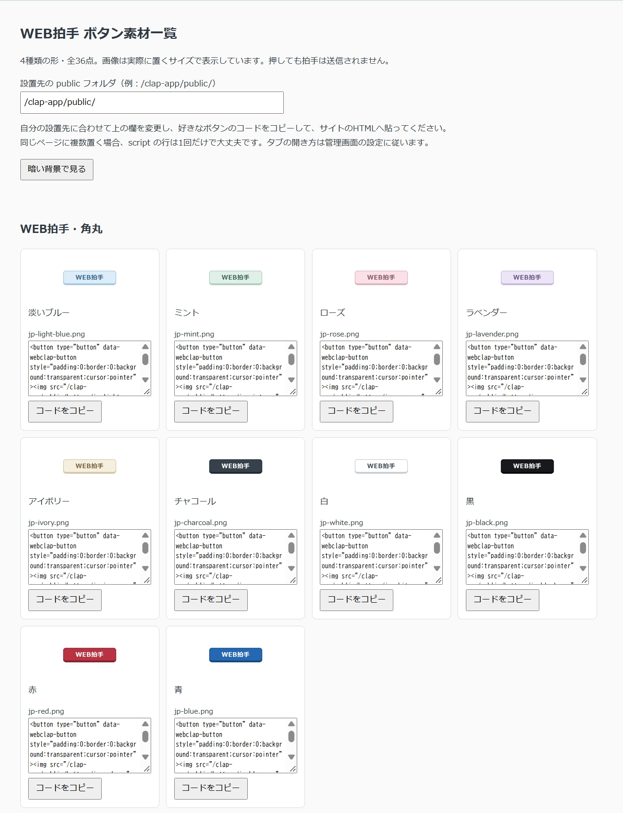
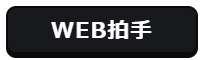

# WEB拍手（再）

## 個人サイトの「好き」を、もう一度。

**蘇る平成文化！**

キリ番！ 踏み逃げ！ 絵チャ！ 同盟！ 相互リンク！

その花道を歩いていた、**個人サイト！**

やつは死んでない。

**WEB拍手も死んでない。**

＼ パチパチパチパチ ／

「読んだよ」 「この作品、好きです」 「続きを楽しみにしています」

長文感想を書くほどじゃない。名前を名乗るほどでもない。

でも、**なんか押したい。**

そんなときに押す、あのボタン。

**WEB拍手（再）**は、自分のWebサイトに設置して、訪問者から拍手やメッセージを受け取れるツールです。

SNSじゃない。いいね数を競うものでもない。

サイトの片隅にそっと置いて、

**「よかったよ」**

を受け取るための、小さな交流の入口です。

あの頃を知っている人には、もう一度。

そして、あの頃を知らない人には。

**日本のオタク文化を育てた個人サイト、その交流を今のあなたも体験してみないか？**

というわけで、

**日本語版 / English version、両方あります。**

---

## 画面の見本

日本語版のテストデータを使った画面例です。公開用に一部の情報を隠しています。

### デザイン設定とお礼のプレビュー

ホーム・機能設定・お返事ページ・ボタン一覧を見る

### ホームとお返事の編集

### 機能設定

### 読者向けのお返事ページ（ダーク）

### ボタン素材一覧と設置コード（一部）

---

## できること

- 👏 **拍手を受け取る**  
  メッセージなしで、拍手だけ送ってもらうこともできます。
- 💬 **匿名OKのメッセージを受け取る**  
  名前を書かなくても送信できます。
- 📅 **拍手数を確認する**  
  今日・今月・日付ごとの拍手やメッセージをカレンダーから確認できます。
- 🎁 **拍手後にお礼を表示する**  
  画像だけ、文章だけ、画像＋文章にも対応。複数登録すればランダム表示もできます。
- ✉️ **届いた感想にお返事を書く**  
  お返事を公開するためのページも最初から用意しています。
- 📧 **メールで通知する**  
  メッセージ付きの拍手が届いたときに通知できます。
- 🎨 **見た目を変える**  
  用意されたテーマだけでなく、HTML・CSSを使ったカスタムにも対応しています。
- 🌏 **タイムゾーン設定対応**  
  設置した地域に合わせて、**その地域の午前0時を基準に日付を切り替えて拍手を集計**できます。

**平成文化をグローバルに。**

日本からでも、海外からでも。あなたのサイトが暮らしている時間で、今日の拍手を数えます。

---

## 「拍手ボタンの素材配布サイト、閉鎖してる＞＜」

時の流れとは残酷なものです。

しかし、

# NO PROBLEM ✋

**今なら期間限定で！！**

……というのは冗談で。

今回、我々は**拍手ボタン素材も36種類同梱しました＾＾**

もちろん追加料金などありません。そもそも本体も無料です。

好きなものを選んで使ってください。

同梱ボタンの見本（36種類）

| | | | | |
| --- | --- | --- | --- | --- |
|  |  |  |  |  |
|  |  |  |  |  |
|  |  |  |  |  |
|  |  |  |  |  |
|  |  |  |  |  |
|  |  |  |  |  |
|  |  |  |  |  |
|  | | | | |

素材一覧から設置先を入力すれば、設置用コードも生成できます。

**「WEB拍手は設置できた。でも押すボタンがない。」**

そんな平成インターネット浦島太郎にも安心のセットとなっております。

---

## これひとつで、個人サイトの交流セットが揃います。

入っているのは、拍手機能だけではありません。

**これひとつで、**

- **拍手ボタン素材**
- **届いた感想にお返事を書くページ**
- **拍手後に表示する簡易ポップアップお礼画面**

**全部まとめて揃います。**

素材サイトを探して、お返事用の場所を別に作って、お礼ページも用意して……

**しなくていいです。**

ZIPひとつ持って帰ってください。

個人サイトの片隅に置く、小さな交流セット。

**まとめて箱に詰めておきました＾＾**

---

## データベース？

**いりません。**

拍手・メッセージ・設定などのデータは、設置したアプリ内に保存します。

必要なのは、主に以下の環境です。

- **PHP 8.3以上**
- **HTTPS**
- 同梱の **`.htaccess` によるアクセス制限**が有効なApache互換環境
- ファイルの保存・ロック
- PHP **Fileinfo**
- メール通知を使う場合は **OpenSSL / SMTP送信**
- サーバー構成によっては **cURL**

初回設定時に、利用できる環境かチェックする機能もあります。

PHPを設置できないホームページサービスや、必要なアクセス制限が働かないサーバーでは利用できません。

---

## ダウンロード

GitHubの **Releases** から、使いたい言語のZIPをダウンロードしてください。

| ファイル | 言語 |
| --- | --- |
| [WEBclap-sai-1.0.0-ja.zip](https://github.com/Geek0426/WEBclap/releases/latest) | 日本語版 |
| [WEBclap-sai-1.0.0-en.zip](https://github.com/Geek0426/WEBclapEnglish/releases/latest) | English |

[English version / Web Clap (Again)](https://github.com/Geek0426/WEBclapEnglish)

ZIPには、アプリ本体の `webclap-sai` フォルダと説明書が入っています。

展開したら、まずは日本語版 → **「説明書.html」**、英語版 → **「Guide.html」** を開いてください。

**説明書を読まずに突撃するタイプの人も、今回は最初だけ読んでください。**

設置方法、必要な環境、使い方、バックアップ、利用条件などは全部そっちに書いてあります。

---

## 設置するときの大事なところ

これは**新規設置用**です。

昔使っていたWEB拍手や、別のアプリのフォルダへ

**「たぶんいけるっしょ」**

と上書きするのはやめてください。

**いけません。**

新しい空の場所へ `webclap-sai` フォルダをアップロードして使います。

その際、隠しファイルの **`.htaccess` も忘れずにアップロード**してください。

また、拍手ボタンを置くページとWEB拍手（再）は、**同じドメイン・同じ通信方式**で利用してください。

別ドメインをまたぐ設置には対応していません。

詳しい設置手順は同梱の説明書をご覧ください。

---

## 動作確認について

日本語版は、制作者のさくらのレンタルサーバーのテスト環境で、初回設定・拍手・メッセージ・メール通知・お返事・画像・カスタム画面の動作を確認しています。

日本語版・英語版ともにローカル環境で自動テストを行っています。

英語版の実サーバー設置は未検証です。

その他のサーバー、PHP 8.3 / 8.4での実行、実スマートフォンでの操作、WordPress編集画面からの設置は未実機検証です。ローカルの自動検査にはPHP 8.5.7を使用しています。

**動いた環境は書く。試してない環境は、試したことにしない。**

そのへんは正直にいきます。

---

## ご利用について

WEB拍手（再）のオリジナル部分の著作権は、制作者のゆずに帰属します。

- ご自身のサイトへの設置・利用ができます。
- 管理画面での設定変更、用意されたカスタム機能でのHTML・CSS編集、設置コードの書き換えができます。
- 同梱のボタン素材は、ご自身のサイトで拍手ボタンとして利用できます。
- **本アプリと同梱のオリジナル素材の再配布・転載、およびアプリ本体の改変は禁止します。**
- 外部ライブラリや第三者の素材には、それぞれのライセンスが適用されます。
- ご自身が登録した画像や文章の権利は、それぞれの権利者に帰属します。

詳しい利用条件と第三者素材の表記は、同梱の説明書をご確認ください。

---

あの頃、誰かのサイトで押した一回の拍手。

今度は、あなたのサイトに置いてみませんか。

**言葉になる前の「好き」も、ひと押しで。**

**WEB拍手（再）**
